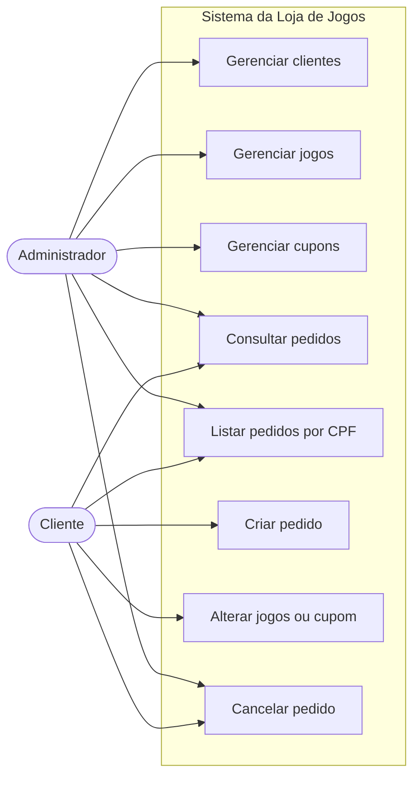
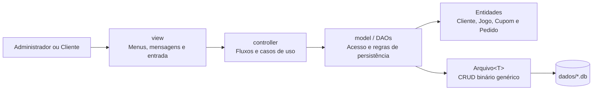

# Loja de Jogos: Trabalho Prático de AED III

> Sistema acadêmico de gerenciamento de clientes, jogos, cupons e pedidos, desenvolvido em Java com persistência própria em arquivos binários.

**Instituição:** Pontifícia Universidade Católica de Minas Gerais  
**Unidade:** Instituto de Ciências Exatas e Informática  
**Disciplina:** Algoritmos e Estruturas de Dados III  
**Integrantes:** Augusto, Ramses e Ravi

## 1. Descrição do problema

O projeto implementa uma loja de jogos executada por menus no terminal. O sistema mantém cadastros de clientes, jogos e cupons e permite criar pedidos com vários jogos, aplicar descontos e preservar os dados entre diferentes execuções.

Em vez de utilizar um banco de dados ou uma biblioteca pronta de persistência, os registros são serializados em arquivos binários. Cada arquivo possui cabeçalho, identificadores sequenciais, exclusão lógica por lápide e uma lista encadeada de espaços excluídos que podem ser reutilizados.

## 2. Objetivo do trabalho

O objetivo é aplicar conceitos de organização de arquivos e estruturas de dados por meio de um sistema capaz de:

- realizar operações de criação, consulta, atualização e exclusão de registros;
- representar relacionamentos entre clientes, pedidos, jogos e cupons;
- armazenar objetos em arquivos binários;
- controlar registros ativos e excluídos logicamente;
- reutilizar espaços liberados por exclusões;
- separar interface, controle, entidades e acesso aos dados.

## 3. Requisitos funcionais

- **RF01 — Gerenciar clientes:** incluir, buscar por ID ou CPF, alterar o nome e/ou os telefones, excluir e listar clientes ativos.
- **RF02 — Gerenciar jogos:** incluir, buscar por ID, alterar, excluir e listar jogos ativos.
- **RF03 — Gerenciar cupons:** incluir, buscar, alterar, excluir e listar cupons ativos; localizar um cupom pelo código ao montar um pedido.
- **RF04 — Criar pedidos:** associar um cliente a um ou mais jogos.
- **RF05 — Aplicar cupons:** vincular opcionalmente um cupom ao pedido e aplicar desconto percentual e/ou valor fixo.
- **RF06 — Calcular o total:** somar os preços dos jogos, aplicar os descontos e impedir que o resultado fique negativo.
- **RF07 — Alterar pedidos:** adicionar ou remover jogos, trocar ou retirar o cupom e recalcular o valor final.
- **RF08 — Consultar pedidos:** buscar por ID, listar todos ou filtrar os pedidos pelo CPF do cliente.
- **RF09 — Cancelar pedidos:** excluir logicamente um pedido.
- **RF10 — Oferecer perfis de navegação:** disponibilizar menus distintos para administrador e cliente.
- **RF11 — Ordenar jogos por preço:** reorganizar `jogos.db` em ordem crescente de preço via ordenação externa por intercalação balanceada.

## 4. Requisitos não funcionais e características técnicas

- Aplicação escrita em **Java**, sem dependências externas.
- Interface textual baseada em menus e entrada pelo console (ponto de entrada principal, `controller.Principal`).
- Interface gráfica opcional em **Java Swing** (pacote `ui`, ponto de entrada `ui.MainUI`), reaproveitando os mesmos DAOs do console — ver seção 12.
- Persistência obrigatória em arquivos binários locais.
- Cabeçalho de 12 bytes em cada arquivo: último ID utilizado e início da lista de espaços excluídos.
- Exclusão lógica por lápide, sem remoção física imediata do registro.
- Reutilização de espaços disponíveis quando um bloco excluído comporta um novo registro.
- Organização do código em camadas por meio dos pacotes `view`, `controller` e `model` (console), com `ui` como camada de apresentação alternativa (Swing) sobre o mesmo `model`.
- Criação automática do diretório `dados/` durante o uso do sistema.

## 5. Atores

### Administrador

Gerencia clientes, jogos e cupons. Também pode buscar pedidos, listar todos os pedidos, consultar pedidos por CPF e cancelá-los.

### Cliente

Acessa as operações de pedidos para consultar, listar por CPF, criar, alterar ou cancelar um pedido. O perfil representa um fluxo de navegação; a versão atual não implementa autenticação.

## 6. Diagrama de caso de uso



## 7. Diagrama entidade-relacionamento


O modelo contém quatro entidades principais:

- **Cliente:** `id_cliente`, `nome`, `cpf`, `nascimento` e `telefones` (multivalorado, um cliente pode possuir vários telefones);
- **Jogo:** `id_jogo`, `titulo`, `desenvolvedora`, `classificacao_indicativa`, `preco` e `ano_lancamento`;
- **Cupom:** `id_cupom`, `codigo`, `valor` e `porcentagem`;
- **Pedido:** `id_pedido`, `id_cliente`, `id_jogos` (multivalorado, a lista de jogos do pedido), `id_cupom`, `valor_final` e `data`.

O relacionamento entre pedidos e jogos é muitos-para-muitos. No DER, ele é representado pela entidade associativa `Pedido_Jogo`. Na implementação atual em arquivos binários, essa associação é armazenada como uma lista de IDs de jogos dentro do próprio registro de `Pedido`.

Os relacionamentos um-para-muitos são implementados por chave estrangeira (FK): o registro do lado N guarda a chave primária (PK) da entidade do lado 1. `Pedido` é o lado N de duas relações desse tipo, através dos campos `idCliente` (FK para `Cliente.id`, relação **Cliente 1:N Pedido**) e `idCupom` (FK para `Cupom.id`, relação **Cupom 1:N Pedido**, usando `-1` quando não há cupom).

O atributo `telefones` de `Cliente` é multivalorado, mas não é modelado por FK: em vez de existir uma entidade `Telefone` separada com uma chave estrangeira apontando para `Cliente`, os números ficam embutidos no próprio registro do cliente (quantidade seguida de cada número, campo fixo de 11 dígitos).

## 8. Modelo de persistência

Cada entidade utiliza uma instância da classe genérica `Arquivo<T>`, responsável pelas operações básicas de persistência. Os dados ficam organizados da seguinte forma:

```text
dados/
├── clientes/clientes.db
├── cupons/cupons.db
├── jogos/jogos.db
└── pedidos/pedidos.db
```

### Cabeçalho do arquivo

| Campo | Tamanho | Finalidade |
| --- | ---: | --- |
| Último ID utilizado | 4 bytes (`int`) | Gera IDs sequenciais para novos registros |
| Início da lista de excluídos | 8 bytes (`long`) | Guarda o endereço do primeiro espaço disponível ou `-1` |

### Organização de cada registro

| Campo | Tamanho | Finalidade |
| --- | ---: | --- |
| Lápide | 1 byte | Espaço indica registro ativo; `*` indica registro excluído |
| Tamanho do registro | 2 bytes (`short`) | Informa quantos bytes devem ser lidos |
| Dados serializados | variável | Conteúdo produzido pelo método `toByteArray()` da entidade |

As entidades implementam a interface `Registro`, que define acesso ao ID e os métodos de serialização e desserialização. Strings, números e datas são gravados com `DataOutputStream`; a leitura utiliza `DataInputStream`. Datas são armazenadas como quantidade de dias desde a época Unix (`LocalDate.toEpochDay()`).

Quando um registro é excluído, sua lápide é alterada e o espaço entra em uma lista encadeada de blocos disponíveis. Em uma atualização, o registro é sobrescrito no mesmo local quando o novo conteúdo cabe no espaço original; caso contrário, o bloco antigo é marcado como excluído e o conteúdo é realocado.

## 9. Índices do sistema

O sistema usa dois índices persistidos em disco, cada um resolvendo uma consulta diferente: a **Hash Extensível** resolve "ache o registro com esta PK" (chave única); a **Árvore B+** resolve "ache todos os registros com esta FK" (chave não única).

### 9.1 Hash Extensível (busca direta por PK)

Cada entidade (`Cliente`, `Jogo`, `Cupom` e `Pedido`) possui um índice em **Hash Extensível** sobre sua chave primária, implementado em `HashExtensivel.java`. Ele mapeia `id -> endereço do registro em disco`, permitindo que `buscarX(id)`, `alterarX` e `excluirX` acessem o registro diretamente pelo endereço (`Arquivo.lerNoEndereco` / `updateNoEndereco` / `deleteNoEndereco`) em vez de percorrer sequencialmente o arquivo de dados até encontrar o ID.

#### Persistência

O índice de cada entidade é gravado em dois arquivos binários dentro da pasta `dados/<entidade>/`:

| Arquivo | Conteúdo |
| --- | --- |
| `idx_id_dir.db` | Diretório: profundidade global (`int`) seguida do vetor de endereços de baldes (`2^profundidadeGlobal` posições, cada uma um `long`). Reescrito por inteiro sempre que o diretório muda (duplica de tamanho). |
| `idx_id_baldes.db` | Baldes de tamanho fixo, cada um com profundidade local (`int`), quantidade de entradas ocupadas (`int`) e até 4 pares chave/referência (`int` + `long`). |

#### Funcionamento

- **Busca:** a chave é mapeada para uma posição do diretório usando seus bits menos significativos (`hash & (2^profundidadeGlobal - 1)`); o diretório aponta para um balde, percorrido linearmente (no máximo 4 entradas) até encontrar a chave.
- **Inserção:** se o balde de destino já estiver cheio, ele é dividido em dois — duplicando o diretório antes, caso sua profundidade local já tenha alcançado a profundidade global — e as entradas são redistribuídas pelo bit recém-considerado.
- **Remoção:** apenas remove a entrada do balde; não há fusão de baldes subdimensionados nem redução da profundidade global (mesma simplificação assumida na `ArvoreBMais`, sem impacto na corretude da busca).
- **Consistência com o CRUD:** toda operação de criação, alteração e exclusão nos DAOs atualiza o índice na mesma chamada. Em um `update` cujo novo conteúdo não coube no espaço original (registro realocado), a entrada é reindexada para o novo endereço. Na primeira vez em que o índice passa a existir sobre um `.db` já povoado, ou depois de `JogoDAO.ordenarPorPreco()` (que reescreve `jogos.db` por inteiro e invalida todos os endereços), o índice é reconstruído varrendo o arquivo de dados (`Arquivo.reconstruirIndice`).

### 9.2 Árvore B+ (consulta por FK `Pedido.idCliente`)

Implementada em `ArvoreBMais.java` e usada só por `PedidoDAO`, é um índice secundário sobre a FK `Pedido.idCliente`: a chave é o ID do cliente, e o valor é o endereço físico do pedido em `pedidos.db`. Resolve `listarPedidosPorCliente(idCliente)` sem varrer o arquivo inteiro.

- **Estrutura:** páginas de tamanho fixo num único arquivo (`idx_cliente.db`). Nós internos guardam só chaves separadoras e ponteiros de filho (sem dado nenhum); folhas guardam os pares `(idCliente, endereço)` e são encadeadas entre si por um ponteiro para a próxima folha, permitindo varredura sequencial sem subir/descer na árvore.
- **Chaves duplicadas:** como vários pedidos podem ter o mesmo `idCliente`, cada ocorrência vira uma entrada própria na folha, ordenada por `(chave, endereço)`. Uma busca desce até a folha mais à esquerda onde aquela chave poderia estar e, a partir dali, acumula entradas continuando pelas folhas encadeadas enquanto a última chave lida não ultrapassar a chave buscada — assim nenhuma ocorrência é perdida mesmo quando o mesmo `idCliente` fica espalhado entre duas folhas.
- **Inserção:** ao dividir uma folha cheia, a chave mediana é copiada pro nó pai e também permanece na folha nova (padrão de árvore B+); ao dividir um nó interno, a chave mediana sobe inteira, sem ficar duplicada em nenhum dos dois filhos.
- **Remoção:** apenas remove a entrada da folha (seguindo a cadeia de folhas se a entrada não estiver na primeira que a busca encontra); não há fusão de nós subdimensionados, mesma simplificação assumida na Hash Extensível.
- **Consistência com o CRUD:** `PedidoDAO.incluirPedido`, `alterarPedido` e `excluirPedido` atualizam a árvore na mesma chamada — inserindo `(idCliente, endereço)` ao criar, removendo e reinserindo com o novo endereço se o pedido for realocado numa alteração, e removendo ao excluir.

## 10. Arquitetura proposta



### Responsabilidades das camadas

- **`view`:** apresenta menus, coleta dados e exibe mensagens no console.
- **`controller`:** coordena as opções de administrador e cliente e chama os DAOs necessários.
- **`model`:** contém as entidades, suas regras de serialização, os DAOs e a classe genérica de arquivo.
- **`ui`:** camada de apresentação alternativa (Swing, seção 12) — substitui `view` + `controller` por telas que chamam os DAOs de `model` diretamente, sem view nem controller próprios.
- **`dados`:** armazena os arquivos binários gerados durante a execução.

## 11. Validação de escopo

| Item | Atendido | Evidência |
| --- | :---: | --- |
| Possui pelo menos três entidades? | Sim | Cliente, Jogo, Cupom e Pedido |
| Possui relacionamento 1:N? | Sim | `Pedido.idCliente` (FK) referencia `Cliente.id`: um cliente pode realizar vários pedidos; `Pedido.idCupom` (FK) referencia `Cupom.id`: um cupom pode ser usado em vários pedidos |
| Possui relacionamento N:N? | Sim | Um pedido contém vários jogos e um jogo pode integrar vários pedidos |
| Possui atributo multivalorado? | Sim | `Cliente.telefones` armazena vários números (campo fixo de 11 dígitos); `Pedido.idJogos` armazena vários IDs |
| Possui campo de data? | Sim | `Cliente.nascimento` e `Pedido.data` |
| Possui campo real? | Sim | `Jogo.preco` e `Pedido.valorFinal` |
| Possui índice para busca direta por PK? | Sim | `HashExtensivel.java`, usado por `ClienteDAO`, `JogoDAO`, `CupomDAO` e `PedidoDAO` |
| Possui índice secundário (Árvore B+) para consulta por FK? | Sim | `ArvoreBMais.java`, usado por `PedidoDAO.listarPedidosPorCliente` sobre a FK `Pedido.idCliente` |
| Possui ordenação externa por intercalação balanceada? | Sim | `Arquivo.ordenarPorIntercalacaoBalanceada`, usado por `JogoDAO.ordenarPorPreco()` para ordenar `Jogo.preco` |

## 12. Interface gráfica (Swing)

Além do console, o sistema tem uma interface gráfica opcional em **Java Swing**, no pacote `ui`. Ela não duplica regra de negócio nenhuma — cada tela chama exatamente os mesmos DAOs do `model` que o console usa (`ClienteDAO`, `JogoDAO`, `CupomDAO`, `PedidoDAO`), é só uma camada de apresentação diferente sobre a mesma persistência.

### Perfis de acesso

A GUI espelha o mesmo fluxo de perfis do console (`Principal` + `PrincipalView.exibirMenuPerfil`): `ui.MainUI` abre perguntando **Admin**, **Cliente** ou **Sair**.

- **Admin** → `TelaPrincipal`, um `JFrame` com `JTabbedPane` de 4 abas (Clientes, Jogos, Cupons, Pedidos). Na aba de Pedidos, o Admin pode buscar (por ID ou CPF), listar todos e cancelar — mas **não** inclui nem altera pedido, igual `MenuPedidos.menu(true)`.
- **Cliente** → `TelaCliente`, um `JFrame` só com a aba de Pedidos, em modo cliente: buscar (ID ou CPF), fazer novo pedido, alterar (jogos/cupom) e cancelar — sem "listar todos" (essa opção não existe pra esse perfil no console) e sem acesso a Clientes/Jogos/Cupons.

### Padrão de cada aba

Cada entidade segue a mesma estrutura: um `JPanel` com `JTable`/`DefaultTableModel` no centro (populada a partir do `listarX()` do DAO) e botões no topo pra cada operação. A tabela é recarregada automaticamente depois de qualquer inclusão, alteração ou exclusão. Erros de qualquer DAO (inclusive problemas de I/O) viram `JOptionPane.showMessageDialog` de erro; sucesso vira um `JOptionPane` informativo.

Inclusão e alteração abrem um `JDialog` modal (`XFormDialog`) com Salvar/Cancelar. As restrições do console foram replicadas nos formulários:

- **Cliente**: no modo editar, CPF e data de nascimento ficam desabilitados — só dá pra mudar nome e telefones (mesma regra de `MenuClientes.alterarCliente`). O editor de telefones valida 11 dígitos antes de aceitar.
- **Jogo**: todos os campos são editáveis (igual `MenuJogos.alterarJogo`). O botão **"Ordenar por preço"** roda `JogoDAO.ordenarPorPreco()` (ordenação externa) e mostra num `JOptionPane` quantos registros foram ordenados e quanto tempo levou.
- **Cupom**: todos os campos são editáveis (igual `MenuCupons.alterarCupom`).
- **Pedido** (`PedidoFormDialog`) é o mais elaborado: resolve o cliente digitando o CPF, deixa escolher vários jogos numa lista de seleção múltipla, e aceita opcionalmente um código de cupom (resolvido via `CupomDAO.buscarCupomPorCodigo` antes de montar o pedido). No modo editar, o cliente do pedido não pode ser trocado — só jogos e cupom, igual o console.

A busca de pedidos por CPF na GUI usa a Árvore B+ sobre a FK `Pedido.idCliente` (`ArvoreBMais.java`, consultada em `PedidoDAO.listarPedidosPorCliente`), do mesmo jeito que o console.

### Executando

Veja "Como executar" — compila junto com o resto (`ui/*.java`) e roda com `java -cp out ui.MainUI`.

## Tecnologias utilizadas

- Java 8 ou superior
- API de arquivos `RandomAccessFile`
- Serialização manual com `DataInputStream` e `DataOutputStream`
- `LocalDate` para datas
- Java Swing (interface gráfica opcional)
- Mermaid para os diagramas renderizados pelo GitHub

## Estrutura do projeto

```text
Aeds3-/
├── controller/
│   ├── Principal.java
│   ├── MenuAdmin.java
│   ├── MenuClientes.java
│   ├── MenuJogos.java
│   ├── MenuCupons.java
│   └── MenuPedidos.java
├── model/
│   ├── Arquivo.java
│   ├── Registro.java
│   ├── HashExtensivel.java        # índice de PK (todas as entidades)
│   ├── ArvoreBMais.java           # índice secundário da FK Pedido.idCliente
│   ├── Cliente.java e ClienteDAO.java
│   ├── Jogo.java e JogoDAO.java
│   ├── Cupom.java e CupomDAO.java
│   └── Pedido.java e PedidoDAO.java
├── view/
│   ├── ConsoleView.java
│   ├── PrincipalView.java
│   ├── AdminView.java
│   ├── ClienteView.java
│   ├── JogoView.java
│   ├── CupomView.java
│   └── PedidoView.java
├── ui/                             # interface gráfica (Swing), opcional — ver seção 12
│   ├── MainUI.java
│   ├── TelaPrincipal.java         # perfil Admin: 4 abas
│   ├── TelaCliente.java           # perfil Cliente: só Pedidos
│   ├── ClientePanel.java e ClienteFormDialog.java
│   ├── JogoPanel.java e JogoFormDialog.java
│   ├── CupomPanel.java e CupomFormDialog.java
│   ├── PedidoPanel.java e PedidoFormDialog.java
│   └── UiUtil.java
└── dados/                         # criado automaticamente durante a execução
    ├── clientes/clientes.db, idx_id_dir.db, idx_id_baldes.db
    ├── cupons/cupons.db, idx_id_dir.db, idx_id_baldes.db
    ├── jogos/jogos.db, idx_id_dir.db, idx_id_baldes.db
    └── pedidos/pedidos.db, idx_id_dir.db, idx_id_baldes.db, idx_cliente.db
```

## Como executar

### Pré-requisito

Tenha um JDK instalado e confirme a disponibilidade dos comandos `javac` e `java`.

### Compilação

Na raiz do projeto, execute (o `ui/*.java` é opcional — só necessário se for usar a interface gráfica):

```bash
javac -encoding UTF-8 -d out controller/*.java model/*.java view/*.java ui/*.java
```

### Execução

**Console** (`controller.Principal` — pede o perfil de acesso no início: Admin ou Cliente):

```bash
java -cp out controller.Principal
```

**Interface gráfica** (`ui.MainUI` — mesma pergunta de perfil, só que numa janela):

```bash
java -cp out ui.MainUI
```

Os arquivos binários serão criados em `dados/`, relativamente ao diretório em que o programa for iniciado. Para preservar a base entre execuções, execute sempre a aplicação a partir da raiz do projeto. Console e GUI compartilham os mesmos arquivos de dados — dá pra alternar entre os dois sem perder nada.

## Observações da implementação atual

- As buscas por ID (PK) de qualquer entidade usam o índice em Hash Extensível (seção 9) e não percorrem mais o arquivo de dados sequencialmente.
- As consultas por CPF e código de cupom (chaves que não são a PK) continuam percorrendo sequencialmente os registros ativos.
- O DER identifica `cpf` e `codigo` como campos únicos, mas a versão atual ainda não impede duplicidades no momento do cadastro.
- A integridade entre arquivos é controlada pela lógica da aplicação, sem chaves estrangeiras físicas.
- O projeto ainda não inclui testes automatizados nem uma ferramenta de build como Maven ou Gradle.

## Autores

- Augusto
- Ramses
- Ravi
