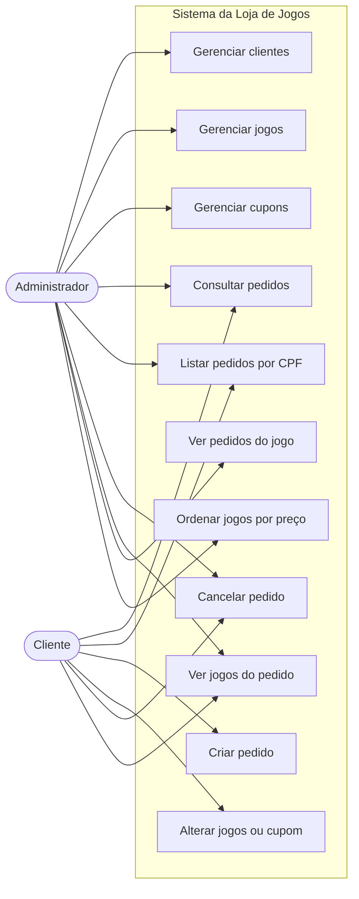
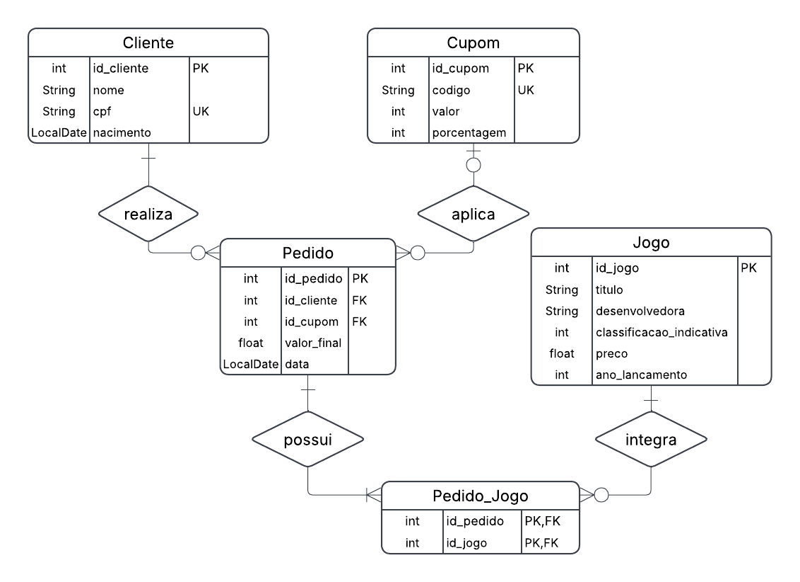
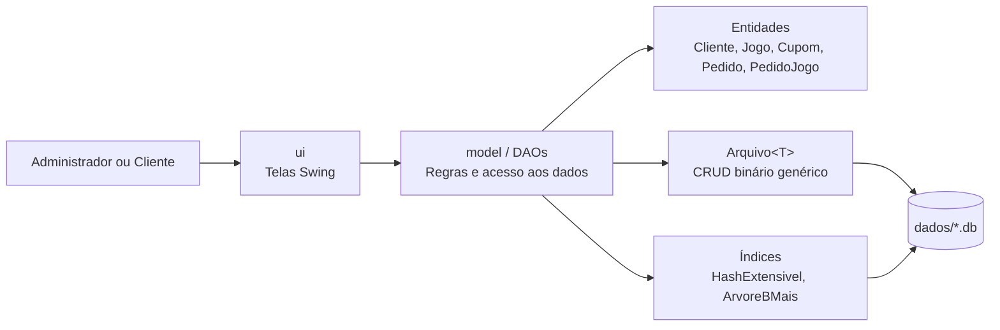

# Loja de Jogos: Trabalho Prático de AED III

> Sistema acadêmico de gerenciamento de clientes, jogos, cupons e pedidos, desenvolvido em Java com persistência própria em arquivos binários, índices em disco (Hash Extensível e Árvore B+) e interface gráfica em Swing.

**Instituição:** Pontifícia Universidade Católica de Minas Gerais  
**Unidade:** Instituto de Ciências Exatas e Informática  
**Disciplina:** Algoritmos e Estruturas de Dados III  
**Integrantes:** Augusto, Ramses e Ravi

## 1. Descrição do problema

O projeto implementa uma loja de jogos. O sistema mantém cadastros de clientes, jogos e cupons e permite criar pedidos com vários jogos, aplicar descontos e preservar os dados entre diferentes execuções.

Em vez de utilizar um banco de dados ou uma biblioteca pronta de persistência, os registros são serializados em arquivos binários. Cada arquivo possui cabeçalho, identificadores sequenciais, exclusão lógica por lápide e uma lista encadeada de espaços excluídos que podem ser reutilizados. As consultas usam índices também persistidos em disco.

A interface definitiva do sistema (Fase III) é gráfica, em **Java Swing** (`ui.MainUI`). A versão em console das fases anteriores continua no repositório apenas como legado.

## 2. Objetivo do trabalho

O objetivo é aplicar conceitos de organização de arquivos e estruturas de dados por meio de um sistema capaz de:

- realizar operações de criação, consulta, atualização e exclusão de registros;
- representar relacionamentos 1:N e N:N entre clientes, pedidos, jogos e cupons;
- armazenar objetos em arquivos binários;
- controlar registros ativos e excluídos logicamente;
- reutilizar espaços liberados por exclusões;
- indexar registros em memória secundária (Hash Extensível e Árvore B+);
- ordenar arquivos por ordenação externa;
- separar interface, entidades e acesso aos dados.

## 3. Requisitos funcionais

- **RF01 — Gerenciar clientes:** incluir, buscar por ID ou CPF, alterar o nome e/ou os telefones, excluir e listar clientes ativos.
- **RF02 — Gerenciar jogos:** incluir, buscar por ID, alterar, excluir e listar jogos ativos.
- **RF03 — Gerenciar cupons:** incluir, buscar, alterar, excluir e listar cupons ativos; localizar um cupom pelo código ao montar um pedido.
- **RF04 — Criar pedidos:** associar um cliente a um ou mais jogos, com quantidade (o mesmo jogo pode ser comprado mais de uma vez no pedido).
- **RF05 — Aplicar cupons:** vincular opcionalmente um cupom ao pedido e aplicar desconto percentual e/ou valor fixo.
- **RF06 — Calcular o total:** somar os preços dos jogos, aplicar os descontos e impedir que o resultado fique negativo.
- **RF07 — Alterar pedidos:** adicionar ou remover jogos (incluir/excluir associações ou mudar a quantidade), trocar ou retirar o cupom e recalcular o valor final.
- **RF08 — Consultar pedidos:** buscar por ID, listar todos ou filtrar os pedidos pelo CPF do cliente.
- **RF09 — Cancelar pedidos:** excluir logicamente um pedido e todas as suas associações com jogos.
- **RF10 — Oferecer perfis de navegação:** disponibilizar telas distintas para administrador e cliente.
- **RF11 — Ordenar jogos por preço:** reorganizar `jogos.db` em ordem crescente de preço via ordenação externa por intercalação balanceada.
- **RF12 — Consultar o relacionamento N:N nos dois sentidos:** listar os jogos de um pedido e listar os pedidos que contêm um jogo.
- **RF13 — Consultar jogos excluídos ainda presentes em pedidos:** listar os itens de pedidos cujo jogo já saiu do catálogo.

## 4. Requisitos não funcionais e características técnicas

- Aplicação escrita em **Java**, sem dependências externas.
- Interface definitiva gráfica em **Java Swing** (pacote `ui`, ponto de entrada `ui.MainUI`); o usuário não precisa do console.
- Persistência obrigatória em arquivos binários locais.
- Cabeçalho de 12 bytes em cada arquivo de dados: último ID utilizado e início da lista de espaços excluídos.
- Exclusão lógica por lápide, sem remoção física imediata do registro.
- Reutilização de espaços disponíveis quando um bloco excluído comporta um novo registro.
- Índices persistidos em disco: Hash Extensível (PK) e Árvore B+ (chaves estrangeiras).
- Organização do código em camadas: `model` (entidades, DAOs, índices) e `ui` (apresentação). Os pacotes `view` e `controller` são a interface de console das fases anteriores.
- Criação automática do diretório `dados/` durante o uso do sistema.

## 5. Atores

### Administrador

Gerencia clientes, jogos e cupons. Consulta, para cada jogo, os pedidos em que ele aparece. Também pode buscar pedidos, listar todos os pedidos, consultar pedidos por CPF, ver os jogos de um pedido e cancelá-los.

### Cliente

Acessa as operações de pedidos: buscar por ID ou CPF, criar pedido, alterar os jogos (incluir/excluir associações) e o cupom, ver os jogos do pedido e cancelar. O perfil representa um fluxo de navegação; a versão atual não implementa autenticação.

## 6. Diagrama de caso de uso



## 7. Diagrama entidade-relacionamento



O modelo contém quatro entidades principais e uma entidade associativa:

- **Cliente:** `id_cliente`, `nome`, `cpf`, `nascimento` e `telefones` (multivalorado, um cliente pode possuir vários telefones);
- **Jogo:** `id_jogo`, `titulo`, `desenvolvedora`, `classificacao_indicativa`, `preco` e `ano_lancamento`;
- **Cupom:** `id_cupom`, `codigo`, `valor` e `porcentagem`;
- **Pedido:** `id_pedido`, `id_cliente`, `id_cupom`, `valor_final` e `data`;
- **Pedido_Jogo** (associativa, N:N): chave composta `(id_pedido, id_jogo)`, `quantidade`, e `titulo` e `preco` copiados do jogo no momento da compra.

### Relacionamentos 1:N

São implementados por chave estrangeira (FK): o registro do lado N guarda a chave primária (PK) da entidade do lado 1. `Pedido` é o lado N de duas relações desse tipo, através dos campos `idCliente` (FK para `Cliente.id`, relação **Cliente 1:N Pedido**) e `idCupom` (FK para `Cupom.id`, relação **Cupom 1:N Pedido**, usando `-1` quando não há cupom).

### Relacionamento N:N (Pedido ↔ Jogo)

Um pedido contém vários jogos e um jogo pode estar em vários pedidos. O relacionamento é implementado pelo arquivo intermediário `Pedido_Jogo` (seção 9).

**Alteração na modelagem (Fase III):** nas fases anteriores, `Pedido` guardava a lista de IDs dos jogos (`id_jogos`, multivalorado) dentro do próprio registro. Agora essa lista saiu de `Pedido`, e cada associação pedido–jogo é um registro próprio em `pedido_jogo.db`. Por isso, o formato binário de `pedidos.db` mudou (veja "Como executar").

### Atributo multivalorado

O atributo `telefones` de `Cliente` é multivalorado, mas não é modelado por FK: em vez de existir uma entidade `Telefone` separada com uma chave estrangeira apontando para `Cliente`, os números ficam embutidos no próprio registro do cliente (quantidade seguida de cada número, campo fixo de 11 dígitos).

## 8. Modelo de persistência

Cada entidade utiliza uma instância da classe genérica `Arquivo<T>`, responsável pelas operações básicas de persistência. Os dados ficam organizados da seguinte forma:

```text
dados/
├── clientes/     clientes.db,    idx_id_dir.db, idx_id_baldes.db
├── cupons/       cupons.db,      idx_id_dir.db, idx_id_baldes.db
├── jogos/        jogos.db,       idx_id_dir.db, idx_id_baldes.db
├── pedidos/      pedidos.db,     idx_id_dir.db, idx_id_baldes.db, idx_cliente.db
└── pedido_jogo/  pedido_jogo.db, idx_pedido.db, idx_jogo.db
```

### Cabeçalho do arquivo

| Campo | Tamanho | Finalidade |
| --- | ---: | --- |
| Último ID utilizado | 4 bytes (`int`) | Gera IDs sequenciais para novos registros |
| Início da lista de excluídos | 8 bytes (`long`) | Guarda o endereço do primeiro espaço disponível ou `-1` |

### Organização de cada registro

| Campo | Tamanho | Finalidade |
| --- | ---: | --- |
| Lápide | 1 byte | Espaço indica registro ativo; `*` indica registro excluído |
| Tamanho do registro | 2 bytes (`short`) | Informa quantos bytes devem ser lidos |
| Dados serializados | variável | Conteúdo produzido pelo método `toByteArray()` da entidade |

As entidades implementam a interface `Registro`, que define acesso ao ID e os métodos de serialização e desserialização. Strings, números e datas são gravados com `DataOutputStream`; a leitura utiliza `DataInputStream`. Datas são armazenadas como quantidade de dias desde a época Unix (`LocalDate.toEpochDay()`).

Quando um registro é excluído, sua lápide é alterada e o espaço entra em uma lista encadeada de blocos disponíveis. Em uma atualização, o registro é sobrescrito no mesmo local quando o novo conteúdo cabe no espaço original; caso contrário, o bloco antigo é marcado como excluído e o conteúdo é realocado.

### Registros de `Pedido` e `Pedido_Jogo`

| Arquivo | Campos serializados |
| --- | --- |
| `pedidos.db` | `id` (`int`), `idCliente` (`int`), `idCupom` (`int`), `valorFinal` (`float`), `data` (`long`, dias desde a época) |
| `pedido_jogo.db` | `id` (`int`), `idPedido` (`int`), `idJogo` (`int`), `titulo` (`UTF`), `preco` (`float`), `quantidade` (`int`) |

## 9. Relacionamento N:N — Pedido_Jogo

### 9.1 Arquivo intermediário

A classe `PedidoJogo` (`model/PedidoJogo.java`) é a entidade associativa. Cada registro representa um jogo dentro de um pedido e é gravado em `dados/pedido_jogo/pedido_jogo.db` pelo mesmo `Arquivo<T>` das outras entidades (cabeçalho, lápide, lista de excluídos).

Além das duas chaves estrangeiras, o item guarda a **quantidade** comprada e uma **cópia do título e do preço do jogo na data da compra**. Assim, se o preço de um jogo mudar ou o jogo sair do catálogo, os pedidos já feitos continuam com os dados e o valor originais. O valor do pedido é a soma de `preço × quantidade` dos itens, menos o desconto do cupom.

`PedidoJogoDAO` (`model/PedidoJogoDAO.java`) concentra as operações sobre as associações:

| Método | Operação |
| --- | --- |
| `incluir(idPedido, jogo, quantidade)` | Inclui a associação e atualiza os dois índices; se o par já existir, soma a quantidade no registro existente |
| `alterar(item)` | Regrava um item existente (nova quantidade), reindexando se o registro for realocado |
| `buscar(idPedido, idJogo)` | Consulta pela chave composta |
| `listarPorPedido(idPedido)` | Jogos de um pedido (índice `idx_pedido.db`) |
| `listarPorJogo(idJogo)` | Pedidos que contêm um jogo (índice `idx_jogo.db`) |
| `excluir(item)` | Exclui uma associação e a remove dos dois índices |
| `excluirPorPedido(idPedido)` | Exclui todas as associações de um pedido (cascata) |

### 9.2 Chave composta e controle de duplicidade

A chave do relacionamento é o par **`(idPedido, idJogo)`**. O registro também tem um campo `id` sequencial, mas só porque `Arquivo<T>` gera um ID para todo registro; ele não é usado para identificar a associação.

Um pedido pode ter o mesmo jogo mais de uma vez, mas isso **não** gera dois registros com o mesmo par: o par aparece uma única vez, e o campo `quantidade` diz quantas unidades foram compradas. A unicidade é garantida em três camadas:

1. **`PedidoJogoDAO.incluir`** chama `buscar(idPedido, idJogo)` antes de gravar. Se o par já existir, nenhum registro novo é criado: a quantidade do item existente é somada e regravada. A busca usa o índice `idx_pedido.db` e só lê os itens daquele pedido.
2. **`PedidoDAO.incluirPedido` / `alterarPedido`** recebem a lista de IDs dos jogos (um ID repetido = uma unidade a mais) e a agrupam em `idJogo → quantidade` antes de montar os itens. Cada jogo vira um único item.
3. **Interface:** no formulário de pedido, adicionar um jogo que já está na lista aumenta a quantidade da linha (exibida como "2× …"), e "Remover" tira uma unidade.

Cliente comprando o mesmo jogo em outro pedido, ou cancelando e refazendo um pedido, não conflita com a chave: cada pedido tem um `idPedido` novo.

### 9.3 Índices do relacionamento

| Índice | Chave | Estrutura | Consulta que resolve |
| --- | --- | --- | --- |
| `pedido_jogo/idx_pedido.db` | `idPedido` → endereço do item | Árvore B+ (chave não única) | Listar todos os jogos de um pedido |
| `pedido_jogo/idx_jogo.db` | `idJogo` → endereço do item | Árvore B+ (chave não única) | Listar todos os pedidos que contêm um jogo |

A Árvore B+ foi escolhida porque as duas chaves se repetem (um pedido tem vários itens; um jogo aparece em vários pedidos). Ela guarda cada ocorrência como uma entrada `(chave, endereço)` nas folhas, que são encadeadas. Assim, a consulta desce uma vez até a primeira ocorrência e percorre as folhas seguintes, sem ler o arquivo inteiro. Os mesmos índices também servem para excluir associações sem varredura.

### 9.4 Consultas nos dois sentidos

- **Pedido → jogos:** `PedidoJogoDAO.listarPorPedido(idPedido)` busca os endereços em `idx_pedido.db` e lê cada item direto pelo endereço (`Arquivo.lerNoEndereco`). `PedidoDAO` usa essa consulta para preencher os jogos de todo pedido que carrega. Na interface: botão **"Ver jogos do pedido"** (aba Pedidos).
- **Jogo → pedidos:** `PedidoJogoDAO.listarPorJogo(idJogo)` faz o mesmo com `idx_jogo.db`. Na interface: botão **"Ver pedidos do jogo"** (aba Jogos).

### 9.5 Integridade referencial

| Operação | Comportamento |
| --- | --- |
| **Inclusão de pedido** | Só grava se o cliente existir e houver pelo menos um jogo válido no catálogo. Os itens são criados depois do pedido, com o `id` do pedido recém-gravado; IDs de jogos inexistentes são ignorados. |
| **Alteração de pedido** | `PedidoDAO.alterarPedido` sincroniza os itens: mantém os que continuam (regravando a quantidade se ela mudou), exclui os retirados (arquivo + dois índices) e inclui os novos (só se o jogo existir). O pedido não pode ficar sem jogos. Se o registro do pedido for realocado, os itens não mudam, pois referenciam o `idPedido` e não o endereço. |
| **Exclusão de pedido** | Cascata: `PedidoDAO.excluirPedido` chama `PedidoJogoDAO.excluirPorPedido`, que remove todos os itens do pedido do arquivo e dos dois índices. |
| **Alteração de jogo** | A PK do jogo não muda. Os itens já gravados mantêm o título/preço da compra; pedidos novos usam os dados atuais. A ordenação externa reescreve `jogos.db`, mas não afeta os itens, que referenciam o `idJogo` e não o endereço. |
| **Exclusão de jogo** | Os itens de pedidos já realizados são preservados como histórico de compra (por isso guardam a cópia de título e preço). Antes de excluir, a interface avisa em quantos pedidos o jogo aparece. Um jogo excluído não pode ser adicionado a pedidos novos ou alterados, pois `JogoDAO.buscarJogo` não o encontra mais. O botão **"Jogos excluídos em pedidos"** lista esses itens. |

## 10. Índices do sistema

O sistema usa dois tipos de índice persistidos em disco, cada um resolvendo uma consulta diferente: a **Hash Extensível** resolve "ache o registro com esta PK" (chave única); a **Árvore B+** resolve "ache todos os registros com esta FK" (chave não única).

| Índice | Arquivo(s) | Estrutura | Usado por |
| --- | --- | --- | --- |
| PK de cada entidade | `<entidade>/idx_id_dir.db` + `idx_id_baldes.db` | Hash Extensível | `buscarX`, `alterarX`, `excluirX` de Cliente, Jogo, Cupom e Pedido |
| `Pedido.idCliente` | `pedidos/idx_cliente.db` | Árvore B+ | `PedidoDAO.listarPedidosPorCliente` |
| `PedidoJogo.idPedido` | `pedido_jogo/idx_pedido.db` | Árvore B+ | `PedidoJogoDAO.listarPorPedido` |
| `PedidoJogo.idJogo` | `pedido_jogo/idx_jogo.db` | Árvore B+ | `PedidoJogoDAO.listarPorJogo` |

### 10.1 Hash Extensível (busca direta por PK)

Implementada em `HashExtensivel.java`. Mapeia `id -> endereço do registro em disco`, permitindo que `buscarX(id)`, `alterarX` e `excluirX` acessem o registro diretamente pelo endereço (`Arquivo.lerNoEndereco` / `updateNoEndereco` / `deleteNoEndereco`) em vez de percorrer o arquivo.

| Arquivo | Conteúdo |
| --- | --- |
| `idx_id_dir.db` | Diretório: profundidade global (`int`) seguida do vetor de endereços de baldes (`2^profundidadeGlobal` posições, cada uma um `long`). Reescrito por inteiro sempre que o diretório muda. |
| `idx_id_baldes.db` | Baldes de tamanho fixo, cada um com profundidade local (`int`), quantidade de entradas ocupadas (`int`) e até 4 pares chave/referência (`int` + `long`). |

- **Busca:** a chave é mapeada para uma posição do diretório usando seus bits menos significativos (`hash & (2^profundidadeGlobal - 1)`); o diretório aponta para um balde, percorrido linearmente (no máximo 4 entradas).
- **Inserção:** se o balde de destino estiver cheio, ele é dividido em dois — duplicando o diretório antes, caso sua profundidade local já tenha alcançado a profundidade global — e as entradas são redistribuídas pelo bit recém-considerado.
- **Remoção:** apenas remove a entrada do balde; não há fusão de baldes nem redução da profundidade global.
- **Diretório sempre lido do disco:** cada busca, inserção ou remoção relê o diretório do arquivo. Vários DAOs (por exemplo, as abas da interface) têm instâncias próprias do índice sobre os mesmos arquivos. Uma cópia só em memória ficaria desatualizada quando outra instância dividisse um balde ou reconstruísse o índice.
- **Consistência com o CRUD:** toda criação, alteração e exclusão nos DAOs atualiza o índice na mesma chamada. Se um `update` realocar o registro, a entrada é reindexada. Na primeira vez em que o índice passa a existir sobre um `.db` já povoado, ou depois de `JogoDAO.ordenarPorPreco()` (que reescreve `jogos.db` e invalida todos os endereços), o índice é reconstruído varrendo o arquivo de dados (`Arquivo.reconstruirIndice`).

### 10.2 Árvore B+ (consulta por chave estrangeira)

Implementada em `ArvoreBMais.java` (ordem 4). A chave é um `int` (a FK) e o valor é o endereço físico do registro no arquivo de dados.

- **Estrutura:** páginas de tamanho fixo num único arquivo. Nós internos guardam só chaves separadoras e ponteiros de filho; folhas guardam os pares `(chave, endereço)` e são encadeadas por um ponteiro para a próxima folha.
- **Chaves duplicadas:** cada ocorrência vira uma entrada própria na folha, ordenada por `(chave, endereço)`. A busca desce até a folha mais à esquerda onde a chave poderia estar e segue pelas folhas encadeadas enquanto a última chave lida não ultrapassar a chave buscada — assim nenhuma ocorrência é perdida quando a mesma chave fica espalhada por várias folhas.
- **Inserção:** ao dividir uma folha cheia, a chave mediana é copiada para o pai e também permanece na folha nova; ao dividir um nó interno, a mediana sobe inteira.
- **Remoção:** remove a entrada `(chave, endereço)` específica, seguindo a cadeia de folhas se necessário; não há fusão de nós subdimensionados.
- **Consistência com o CRUD:** `PedidoDAO` atualiza `idx_cliente.db` ao criar, realocar e excluir pedidos; `PedidoJogoDAO` atualiza `idx_pedido.db` e `idx_jogo.db` ao incluir e excluir associações.

## 11. Arquitetura



### Responsabilidades das camadas

- **`ui`:** interface definitiva (Swing). As telas chamam os DAOs de `model` diretamente; nenhuma regra de negócio fica na interface.
- **`model`:** entidades, serialização, DAOs (regras de negócio e integridade), índices e a classe genérica de arquivo.
- **`view` + `controller`:** interface de console das Fases I e II, mantida no repositório como legado. Usa os mesmos DAOs.
- **`dados`:** arquivos binários gerados durante a execução.

## 12. Interface gráfica (Swing)

### Perfis de acesso

`ui.MainUI` abre perguntando **Admin**, **Cliente** ou **Sair**. Cada tela tem um botão **"← Voltar (trocar perfil)"**.

- **Admin** → `TelaPrincipal`, um `JFrame` com 4 abas (Clientes, Jogos, Cupons, Pedidos). Na aba Pedidos, o Admin busca (por ID ou CPF), lista todos, vê os jogos de um pedido e cancela, mas **não** inclui nem altera pedidos.
- **Cliente** → `TelaCliente`, só com a aba Pedidos: buscar (ID ou CPF), novo pedido, editar (jogos/cupom), ver jogos do pedido e cancelar.

### Padrão de cada aba

Cada entidade tem um `JPanel` com uma `JTable` no centro (preenchida pelo `listarX()` do DAO) e botões no topo para cada operação. A tabela é recarregada depois de cada inclusão, alteração ou exclusão. Erros dos DAOs viram uma mensagem de erro (`JOptionPane`); sucesso vira uma mensagem informativa.

Inclusão e alteração abrem um `JDialog` modal (`XFormDialog`) com Salvar/Cancelar:

- **Cliente:** ao editar, CPF e data de nascimento ficam desabilitados; só nome e telefones mudam. O editor de telefones valida 11 dígitos.
- **Jogo:** todos os campos são editáveis. Botões extras:
  - **"Ordenar por preço"** — roda `JogoDAO.ordenarPorPreco()` (ordenação externa) e mostra quantos registros foram ordenados e o tempo gasto;
  - **"Ver pedidos do jogo"** — consulta N:N no sentido jogo → pedidos (`idx_jogo.db`);
  - **"Jogos excluídos em pedidos"** — itens de pedidos cujo jogo já saiu do catálogo.
- **Cupom:** todos os campos são editáveis.
- **Pedido** (`PedidoFormDialog`): resolve o cliente pelo CPF, tem duas listas ("Jogos disponíveis" e "Jogos no pedido") com botões **Adicionar >>** / **<< Remover** para incluir e excluir associações, e aceita um código de cupom opcional. Adicionar de novo um jogo que já está no pedido aumenta a quantidade (a linha mostra "2× …"); "Remover" tira uma unidade e, na última, exclui a associação. Ao editar, o cliente não pode ser trocado. Na aba Pedidos, **"Ver jogos do pedido"** faz a consulta N:N no sentido pedido → jogos (`idx_pedido.db`), mostrando título, quantidade, preço unitário pago, subtotal e a situação atual do jogo no catálogo.

## 13. Validação de escopo

| Item | Atendido | Evidência |
| --- | :---: | --- |
| Possui pelo menos três entidades? | Sim | Cliente, Jogo, Cupom e Pedido |
| Possui relacionamento 1:N? | Sim | `Pedido.idCliente` → `Cliente.id`; `Pedido.idCupom` → `Cupom.id` |
| Possui relacionamento N:N com arquivo intermediário binário? | Sim | `PedidoJogo` / `PedidoJogoDAO`, arquivo `pedido_jogo.db` |
| Arquivo intermediário com chave composta e sem duplicidade? | Sim | Chave `(idPedido, idJogo)`, verificada em `PedidoJogoDAO.incluir`; compras repetidas viram `quantidade` |
| Consultas N:N nos dois sentidos com índices em disco? | Sim | Árvores B+ `idx_pedido.db` e `idx_jogo.db` |
| Integridade referencial do N:N? | Sim | Seção 9.5 |
| Possui atributo multivalorado? | Sim | `Cliente.telefones` (campo fixo de 11 dígitos) |
| Possui campo de data? | Sim | `Cliente.nascimento` e `Pedido.data` |
| Possui campo real? | Sim | `Jogo.preco`, `Pedido.valorFinal` e `PedidoJogo.preco` |
| Possui índice para busca direta por PK? | Sim | `HashExtensivel.java`, usado por `ClienteDAO`, `JogoDAO`, `CupomDAO` e `PedidoDAO` |
| Possui índice secundário (Árvore B+) para consulta por FK? | Sim | `ArvoreBMais.java`: `Pedido.idCliente`, `PedidoJogo.idPedido`, `PedidoJogo.idJogo` |
| Possui ordenação externa por intercalação balanceada? | Sim | `Arquivo.ordenarPorIntercalacaoBalanceada`, usado por `JogoDAO.ordenarPorPreco()` |
| Interface definitiva sem console? | Sim | `ui.MainUI` (Swing) |

## 14. Formulário de Decisões de Projeto (Fase III)

**1. Qual relacionamento N:N foi implementado e quais entidades estão envolvidas?**  
**Pedido ↔ Jogo.** Um pedido contém vários jogos e um jogo pode estar em vários pedidos. A entidade associativa é `Pedido_Jogo` (classe `PedidoJogo`), gravada em `dados/pedido_jogo/pedido_jogo.db`.

**2. Como foi representada a chave composta do arquivo intermediário e como o sistema garante que uma mesma associação não seja cadastrada mais de uma vez?**  
A chave é o par `(idPedido, idJogo)`, gravado em cada registro de `pedido_jogo.db`. Antes de gravar, `PedidoJogoDAO.incluir` consulta `buscar(idPedido, idJogo)` (pelo índice de `idPedido`). Se a associação já existe, nenhum registro novo é criado: o campo `quantidade` do item existente é incrementado. Assim, um pedido pode ter várias unidades do mesmo jogo sem que o par se repita no arquivo. `PedidoDAO` também agrupa os IDs repetidos em `idJogo → quantidade` antes de gravar. O campo `id` sequencial do registro existe só por exigência do `Arquivo<T>` genérico.

**3. Quais índices foram criados para o arquivo intermediário?**

| Índice | a. Chave | b. Estrutura | c. Consulta eficiente |
| --- | --- | --- | --- |
| `idx_pedido.db` | `idPedido` → endereço do item em `pedido_jogo.db` | Árvore B+ com chaves duplicadas e folhas encadeadas | Listar os jogos de um pedido; verificar duplicidade de `(idPedido, idJogo)`; excluir os itens de um pedido |
| `idx_jogo.db` | `idJogo` → endereço do item em `pedido_jogo.db` | Árvore B+ com chaves duplicadas e folhas encadeadas | Listar os pedidos que contêm um jogo; contar em quantos pedidos um jogo aparece antes de excluí-lo |

**4. Como são realizadas as consultas nos dois sentidos do relacionamento N:N?**  
Cada sentido tem sua própria Árvore B+. Para listar os jogos de um pedido, `listarPorPedido(idPedido)` busca em `idx_pedido.db` todos os endereços com aquela chave (descendo até a folha e seguindo o encadeamento) e lê cada item direto pelo endereço. Para listar os pedidos de um jogo, `listarPorJogo(idJogo)` faz o mesmo em `idx_jogo.db`. Nenhuma das duas percorre `pedido_jogo.db` sequencialmente. Na interface, as consultas estão nos botões "Ver jogos do pedido" (aba Pedidos) e "Ver pedidos do jogo" (aba Jogos).

**5. Como o sistema mantém a integridade referencial entre o arquivo intermediário e as entidades relacionadas nas operações de inclusão, alteração e exclusão?**  
- *Inclusão:* um pedido só é gravado se o cliente existir e houver ao menos um jogo existente; uma associação só é criada para um pedido recém-gravado e um jogo encontrado pelo índice de PK, e nunca duplicada (um par repetido soma a quantidade).  
- *Alteração:* ao alterar um pedido, as associações são sincronizadas (removidas do arquivo e dos dois índices, regravadas com a nova quantidade, ou incluídas se o jogo existir), e o pedido não pode ficar sem jogos. Alterar um jogo não afeta as associações, que guardam o `idJogo` (imutável) e a cópia de título e preço da compra; o mesmo vale para a ordenação externa de `jogos.db`.  
- *Exclusão:* excluir um pedido exclui em cascata todas as suas associações (arquivo e índices). Excluir um jogo preserva os itens dos pedidos já feitos como histórico de compra (com título e preço copiados), e a interface avisa quantos pedidos contêm o jogo. O jogo excluído não pode mais entrar em pedidos novos ou alterados.

## Tecnologias utilizadas

- Java 8 ou superior
- Java Swing (interface)
- API de arquivos `RandomAccessFile`
- Serialização manual com `DataInputStream` e `DataOutputStream`
- `LocalDate` para datas
- Mermaid para os diagramas renderizados pelo GitHub

## Estrutura do projeto

```text
.
├── model/
│   ├── Arquivo.java               # CRUD binário genérico + ordenação externa
│   ├── Registro.java
│   ├── HashExtensivel.java        # índice de PK (todas as entidades)
│   ├── ArvoreBMais.java           # índices de FK (Pedido.idCliente, PedidoJogo.idPedido/idJogo)
│   ├── Cliente.java e ClienteDAO.java
│   ├── Jogo.java e JogoDAO.java
│   ├── Cupom.java e CupomDAO.java
│   ├── Pedido.java e PedidoDAO.java
│   └── PedidoJogo.java e PedidoJogoDAO.java   # relacionamento N:N
├── ui/                            # interface definitiva (Swing)
│   ├── MainUI.java                # ponto de entrada: escolha de perfil
│   ├── TelaPrincipal.java         # perfil Admin: 4 abas
│   ├── TelaCliente.java           # perfil Cliente: só Pedidos
│   ├── ClientePanel.java e ClienteFormDialog.java
│   ├── JogoPanel.java e JogoFormDialog.java
│   ├── CupomPanel.java e CupomFormDialog.java
│   ├── PedidoPanel.java e PedidoFormDialog.java
│   └── UiUtil.java
├── controller/                    # console (legado, Fases I e II)
├── view/                          # console (legado, Fases I e II)
└── dados/                         # criado automaticamente durante a execução (seção 8)
```

## Como executar

### Pré-requisito

Tenha um JDK (8 ou superior) instalado e confirme a disponibilidade dos comandos `javac` e `java`.

### Compilação

Na raiz do projeto:

```bash
javac -encoding UTF-8 -d out model/*.java ui/*.java controller/*.java view/*.java
```

### Execução

```bash
java -cp out ui.MainUI
```

Os arquivos binários são criados em `dados/`, relativamente ao diretório em que o programa é iniciado. Para preservar a base entre execuções, execute sempre a aplicação a partir da raiz do projeto.

> **Atualizando de uma versão anterior (Fases I/II):** o formato de `pedidos.db` mudou na Fase III (os jogos saíram do registro do pedido e foram para `pedido_jogo.db`). Apague a pasta `dados/` antes da primeira execução desta versão.

A interface de console das fases anteriores ainda pode ser executada com `java -cp out controller.Principal` e usa os mesmos arquivos de dados.

## Observações da implementação atual

- As buscas por ID (PK) de qualquer entidade usam a Hash Extensível; as consultas por FK e as do N:N usam Árvores B+.
- As consultas por CPF e por código de cupom (que não são a PK) percorrem sequencialmente os registros ativos.
- O DER identifica `cpf` e `codigo` como campos únicos, mas a versão atual ainda não impede duplicidades no momento do cadastro.
- A integridade entre arquivos é controlada pela lógica da aplicação (DAOs), sem chaves estrangeiras físicas. Excluir um cliente ou um cupom não altera os pedidos que os referenciam; a interface mostra "ID x" quando o cliente ou o cupom não existe mais.
- Os índices não fazem fusão de nós/baldes na remoção (simplificação que não afeta a corretude das buscas).
- O projeto não usa ferramenta de build como Maven ou Gradle.

## Autores

- Augusto
- Ramses
- Ravi
